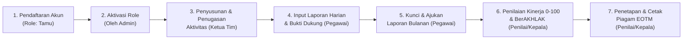

# Buku Pedoman & Panduan Alur Kerja Website REBAHAN
**Sistem Manajemen Kinerja Tim — BPS Kabupaten Mempawah (6104)**

> [!NOTE]
> Dokumen ini merupakan panduan resmi penggunaan aplikasi **REBAHAN** (*Rencana Kerja & Laporan Aktivitas Harian*) BPS Kabupaten Mempawah untuk seluruh peran pengguna (**Tamu**, **Pegawai**, **Ketua Tim**, **Penilai / Kepala**, dan **Administrator**).

---

## 1. Gambaran Umum & Alur Kerja Sistem

Aplikasi **REBAHAN** mengintegrasikan perencanaan kinerja berjenjang (Tujuan $\rightarrow$ Sasaran $\rightarrow$ IKU $\rightarrow$ Kegiatan $\rightarrow$ Sub Kegiatan $\rightarrow$ Aktivitas), pencatatan laporan harian pegawai beserta bukti dukung, penguncian laporan bulanan, evaluasi kinerja numerik (`0–100`) & perilaku **BerAKHLAK** (`1–5`), hingga penetapan serta pencetakan piagam **Employee of the Month (EOTM)** secara otomatis.

---

## 2. Matriks Hak Akses Menu Berdasarkan Role

| Menu / Fitur | Tamu | Pegawai | Ketua Tim | Penilai / Kepala | Admin |
| :--- | :---: | :---: | :---: | :---: | :---: |
| **Halaman Tunggu Persetujuan** | ✅ | — | — | — | — |
| **Dasbor Kinerja** | — | ✅ *(Tugas Saya)* | ✅ *(Monitoring)* | ✅ *(Antrean Nilai)* | ✅ *(Penuh)* |
| **Rencana & Aktivitas** | — | ✅ *(Tugas Milik Sendiri & Lapor)* | ✅ *(Kelola & Tugaskan Semua)* | — | ✅ *(Kelola & Tugaskan Semua)* |
| **Lapor Harian & Kunci Bulanan** | — | ✅ | — | — | — |
| **Penilaian Bulanan (0–100 & BerAKHLAK)** | — | — | — | ✅ | ✅ |
| **Rekap Kinerja & Unduh CSV** | — | ✅ *(Hanya Milik Sendiri)* | ✅ *(Seluruh Tim)* | ✅ *(Seluruh Tim)* | ✅ *(Seluruh Tim)* |
| **Pegawai Terbaik (EOTM)** | — | ✅ *(Lihat)* | ✅ *(Lihat)* | ✅ *(Lihat & Cetak Piagam)* | ✅ *(Lihat & Cetak Piagam)* |
| **Nilai Saya** | — | ✅ | — | — | ✅ |
| **Anggota Tim / Manajemen Pengguna** | — | — | ✅ *(Lihat)* | — | ✅ *(Kelola Akun & Role)* |

---

## 3. Panduan Lengkap per Role

### 3.1. Role: Tamu (Pendaftar Baru)

Setiap pengguna yang baru mendaftar melalui halaman awal secara otomatis berstatus **Tamu** demi menjaga keamanan data internal tim.

1. **Cara Mendaftar Akun Baru:**
   - Buka halaman utama aplikasi, lalu klik tombol **Daftar Akun Baru**.
   - Isi **Email / Username**, **Nama Lengkap**, dan **Kata Sandi** (minimal 6 karakter).
   - Klik **Daftar Akun**, lalu masuk (*login*) menggunakan akun tersebut.
2. **Menunggu Persetujuan Admin:**
   - Setelah masuk, layar akan menampilkan halaman **"Akun Menunggu Persetujuan"**.
   - Hubungi **Administrator** agar peran akun Anda diubah menjadi **Pegawai**, **Ketua Tim**, atau **Penilai**.

---

### 3.2. Role: Pegawai

Pegawai bertugas melaksanakan aktivitas yang ditugaskan, mencatat laporan capaian harian, melampirkan bukti dukung, dan mengunci laporan pada akhir bulan.

#### A. Memantau Tugas di Dasbor
- Pada tab **Dasbor**, panel **Tugas Saya** menampilkan:
  - Daftar aktivitas yang ditugaskan kepada Anda beserta persentase progresnya.
  - Status penguncian laporan bulan berjalan (*Sudah Dikunci* / *Belum Dikunci*).
  - Status apakah laporan bulan berjalan sudah dinilai oleh Penilai.

#### B. Mencatat Laporan Harian
1. Masuk ke tab **Lapor Harian** (atau klik tombol **Lapor** langsung pada kartu aktivitas di tab **Rencana & Aktivitas**).
2. Pilih **Bulan Laporan** pada pemilih periode di bagian atas.
3. Klik tombol **+ Buat Laporan Baru** dan lengkapi kolom berikut:
   - **Aktivitas**: Pilih aktivitas yang Anda kerjakan. Satuan target akan tampil otomatis.
   - **Tanggal**: Tanggal pelaksanaan pekerjaan.
   - **Capaian Hari Ini**: Jumlah volume output yang diselesaikan pada hari tersebut.
   - **Uraian Pekerjaan**: Deskripsi singkat hasil pekerjaan.
   - **Bukti Dukung**:
     - Pilih **Link URL** untuk menempelkan tautan Google Drive/dokumen, atau
     - Pilih **Unggah File** untuk mengunggah gambar/PDF (maksimal $\pm 8\text{ MB}$, otomatis tersimpan ke Google Drive tim).
4. Klik **Simpan**. Selama laporan bulan tersebut belum dikunci, Anda masih dapat mengubah (ikon pensil) atau menghapus (ikon tempat sampah) laporan harian.

#### C. Mengunci & Mengajukan Laporan Bulanan
1. Setelah seluruh pekerjaan bulan berjalan selesai dicatat di tab **Lapor Harian**, klik tombol **Kunci & Ajukan Laporan**.
2. Konfirmasi pengajuan pada kotak dialog yang muncul.
3. Setelah dikunci:
   - Status berubah menjadi **Laporan Terkunci** dan nama Anda masuk ke antrean siap dinilai pada akun **Penilai**.
   - Anda **tidak dapat** menambah, mengubah, atau menghapus laporan pada bulan tersebut.
   - Jika ada kekeliruan dan Penilai **belum** memberikan nilai, Anda dapat mengklik tombol **Batalkan Pengajuan**. Jika sudah dinilai, mintalah Penilai/Admin menekan tombol **Buka Kunci Laporan**.

#### D. Melihat Rekap Aktivitas & Log Laporan Pribadi
- Buka tab **Rekap Saya** untuk melihat dan mengunduh CSV atas **aktivitas yang ditugaskan kepada Anda saja** beserta **log laporan harian pribadi Anda** (aktivitas dan laporan milik pegawai lain tidak ditampilkan).

#### E. Melihat Hasil Evaluasi Bulanan
- Buka tab **Nilai Saya** untuk melihat riwayat **Nilai Kinerja (`0–100`)**, predikat kinerja, rincian bintang 7 aspek **BerAKHLAK (`1–5`)**, **Skor Akhir**, serta catatan evaluasi dari Penilai.

---

### 3.3. Role: Ketua Tim

Ketua Tim bertanggung jawab menerjemahkan struktur rencana kinerja menjadi aktivitas operasional, menetapkan target dan periode waktu, serta menugaskan Pegawai (PIC).

#### A. Menyusun & Menugaskan Aktivitas
1. Buka tab **Rencana & Aktivitas**.
2. Gunakan kotak pencarian atau klik pohon hierarki secara berurutan:
   $$\text{Tujuan} \rightarrow \text{Sasaran} \rightarrow \text{IKU} \rightarrow \text{Kegiatan} \rightarrow \text{Sub Kegiatan}$$
3. Pada tingkat **Sub Kegiatan**, klik tombol **+ Tambah Aktivitas**:
   - **Nama Aktivitas**: Nama rincian pekerjaan (terisi otomatis dari nama Sub Kegiatan, dapat disesuaikan).
   - **Target & Satuan**: Volume target (angka) beserta satuannya (misal: `dokumen`, `responden`, `laporan`, `%`).
   - **Periode Mulai & Selesai**: Rentang jadwal pelaksanaan.
   - **Ditugaskan ke Pegawai**: Klik nama-nama pegawai (chip) yang menjadi PIC aktivitas tersebut.
4. Klik **Simpan**.

#### B. Memantau Progres & Beban Kerja Tim
1. **Dasbor Kinerja**:
   - Panel **Aktivitas Belum Ditugaskan**: Menampilkan daftar aktivitas yang belum memiliki PIC agar segera ditugaskan.
   - Panel **Menunggu Penilaian**: Menampilkan daftar pegawai yang sudah mengunci laporan bulanan tetapi belum dinilai.
   - Panel **Aktivitas Perlu Perhatian** & **Kontribusi Pegawai**: Menampilkan aktivitas dengan capaian terendah dan akumulasi laporan per pegawai.
2. **Rekap Tim**:
   - Saring capaian berdasarkan Aktivitas, Pegawai, atau rentang tanggal, lalu klik **Unduh CSV** pada tabel **Rekap per Aktivitas** maupun **Log Laporan Harian**.

---

### 3.4. Role: Penilai / Kepala

Role **Penilai** (Kepala BPS / Pejabat Penilai) bertugas mengevaluasi kinerja dan perilaku BerAKHLAK pegawai setiap bulan serta mencetak **Piagam Penghargaan Employee of the Month (EOTM)**.

> [!IMPORTANT]
> Penilai hanya dapat memberikan nilai kepada pegawai yang **sudah mengunci & mengajukan laporan bulanan** pada periode tersebut.

#### A. Memberikan Penilaian Bulanan
1. Buka tab **Penilaian Bulanan** (atau klik tombol **Nilai Sekarang** dari pengingat di **Dasbor**).
2. Pilih **Periode Bulan** yang akan dievaluasi.
3. Pada panel kiri (**Belum Dinilai**), pegawai yang sudah mengunci laporan akan memiliki badge **Menunggu Penilaian** dan tombol **Beri Nilai** yang aktif.
4. Klik **Beri Nilai**, lalu isi formulir evaluasi:
   - **Nilai Kinerja Keseluruhan (`0–100`)**: Ketik bilangan bulat `0–100` atau geser *slider*. Badge predikat akan menyesuaikan secara otomatis:
     - `91–100` : **Sangat Baik**
     - `76–90` : **Baik**
     - `61–75` : **Cukup**
     - `51–60` : **Kurang**
     - `0–50` : **Sangat Kurang**
   - **Nilai Karakter BerAKHLAK (`1–5`)**: Berikan skor `1` (*Sangat Kurang*) sampai `5` (*Sangat Baik*) untuk 7 aspek:
     1. *Berorientasi Pelayanan*
     2. *Akuntabel*
     3. *Kompeten*
     4. *Harmonis*
     5. *Loyal*
     6. *Adaptif*
     7. *Kolaboratif*
   - **Catatan Evaluasi / Rekomendasi**: Isi apresiasi atau arahan perbaikan bagi pegawai.
5. Klik **Simpan Penilaian**.
6. Jika pegawai perlu merevisi laporan bulanan yang sudah telanjur dikunci, klik tombol ikon **Buka Kunci Laporan** ($\🔓$) di samping nama pegawai.

#### B. Mencetak Piagam Employee of the Month (EOTM)
1. Buka tab **Pegawai Terbaik**.
2. Pilih **Periode Penghargaan** (bulan dan tahun).
3. Pada *Hero Card* pemenang (atau pada kartu di **Galeri Pemenang Sebelumnya**), klik tombol **Cetak Piagam EOTM** (ikon printer).
4. Akan muncul dialog konfigurasi beserta **Pratinjau Piagam** secara langsung (*live preview*):
   - **Nomor Piagam**: Terisi format standar otomatis per bulan, dapat diedit sesuai penomoran surat keluar.
   - **Tempat & Tanggal Ditetapkan**: Contoh `Mempawah, 2 November 2026`.
   - **Jabatan / Tim Penerima**: Contoh `Pegawai BPS Kabupaten Mempawah`.
   - **Jabatan Penandatangan**: Default `Kepala Badan Pusat Statistik Kabupaten Mempawah`.
   - **Nama Kepala BPS & NIP Penandatangan**: Tersimpan otomatis di browser setelah dicetak pertama kali sehingga tidak perlu diketik ulang setiap bulan.
5. Klik tombol **Cetak / Simpan PDF**. Pilih printer atau pilih **Save as PDF** dengan orientasi **Landscape (A4)**.

---

### 3.5. Role: Administrator (Admin)

Administrator memiliki akses penuh ke seluruh fitur di atas ditambah pengelolaan pengguna pada tab **Manajemen Pengguna**.

1. **Menyetujui Pendaftaran Akun Baru (Tamu):**
   - Buka tab **Manajemen Pengguna**.
   - Jika ada pendaftar baru, akan muncul panel kuning **Pendaftaran Baru / Tamu**.
   - Klik tombol **Ubah Peran / Data** (ikon pensil) pada pengguna tersebut, ubah **Peran** dari `Tamu` menjadi `Pegawai`, `Ketua Tim`, `Penilai`, atau `Admin`, lalu klik **Simpan**.
2. **Menambah Pengguna Secara Langsung:**
   - Klik tombol **+ Tambah Admin / Ketua Tim / Penilai / Pegawai** pada masing-masing panel, isi Username, Nama Lengkap, Peran, dan Kata Sandi awal, lalu klik **Simpan**.
3. **Mereset Kata Sandi atau Menghapus Pengguna:**
   - Klik ikon pensil pada baris pengguna, isi kolom **Kata Sandi Baru**, lalu klik **Simpan** (kosongkan jika hanya mengubah nama/peran).
   - Klik ikon tempat sampah merah untuk menghapus pengguna beserta penugasan terkait.

---

## 4. Metodologi Perhitungan Employee of the Month (EOTM)

Penentuan **Pegawai Terbaik (Employee of the Month)** dilakukan secara objektif dan transparan oleh sistem berdasarkan rumus berikut:

### 4.1. Rumus Skor Akhir (Skala 0–100)
Setiap pegawai yang telah dinilai pada bulan berjalan memperoleh **Skor Akhir** dengan bobot **60% Nilai Kinerja** dan **40% Indeks BerAKHLAK**:

$$\text{Indeks BerAKHLAK} = \frac{\text{Pelayanan} + \text{Akuntabel} + \text{Kompeten} + \text{Harmonis} + \text{Loyal} + \text{Adaptif} + \text{Kolaboratif}}{7}$$

$$\text{Skor Akhir} = \left(0{,}60 \times \text{Nilai Kinerja}\right) + \left(0{,}40 \times \frac{\text{Indeks BerAKHLAK}}{5} \times 100\right)$$

> [!TIP]
> **Kompatibilitas Data Lama:** Jika terdapat data penilaian terdahulu yang masih tersimpan dalam bentuk kategori teks, sistem otomatis mengonversinya menjadi angka: `Sangat baik` = `95`, `Baik` = `85`, `Cukup baik` = `70`, dan `Tidak baik` = `50`.

### 4.2. Aturan Penentu Jika Skor Seri (*Tie-Breaker*)
Apabila terdapat dua atau lebih pegawai dengan **Skor Akhir** yang sama persis pada bulan yang sama, sistem menentukan peringkat pertama secara berurutan berdasarkan:
1. **Aktivitas Terbanyak**: Jumlah laporan harian yang diinput pada bulan tersebut lebih banyak.
2. **Input Tercepat**: Waktu pencatatan laporan pertama (*timestamp* `createdAt`) yang lebih awal di bulan tersebut.
3. **Pemerataan Kemenangan**: Jumlah kemenangan EOTM pada bulan-bulan sebelumnya yang lebih sedikit (`prevWins` lebih kecil).
4. **Penentuan Deterministik**: Nilai *hash* deterministik berbasis ID pegawai dan periode bulan.
